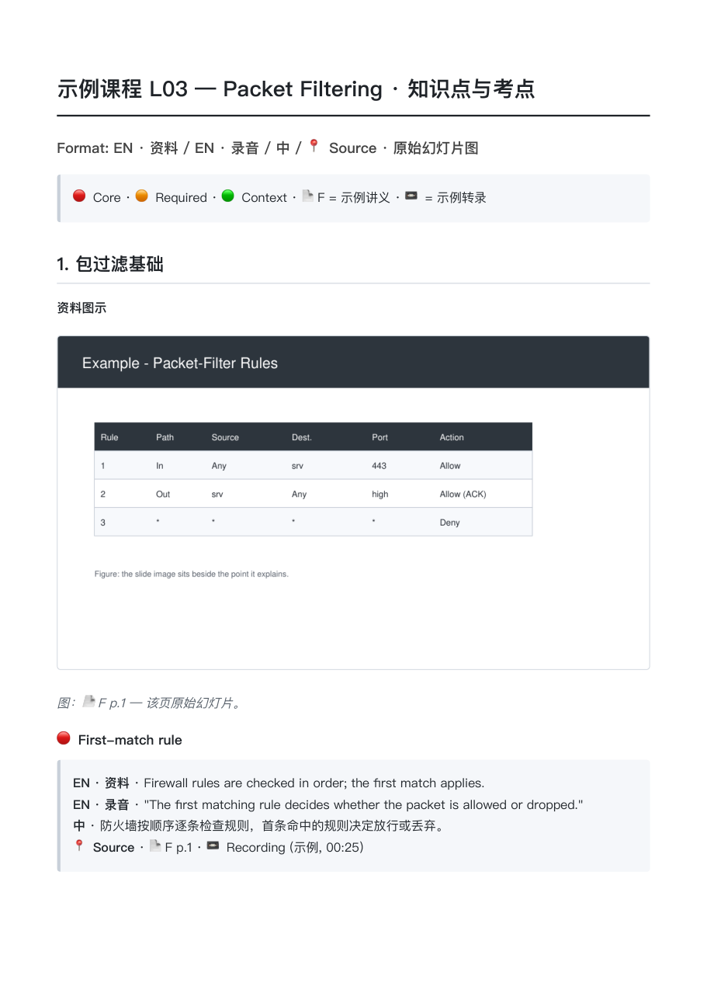

# lecture-to-exam

[](LICENSE)
[](https://github.com/Jing-xl-xl/lecture-to-exam/actions/workflows/tests.yml)

**把课程录音 + 讲义，变成可直接用于期末开卷考试的复习资料。**

> **EN** · An agent skill that turns lecture recordings (Zoom official transcript) + slide decks
> into (A) a bilingual knowledge-point handout with every original slide embedded, and
> (B) an 11-part, text-only exam review handbook. No transcription, no outside knowledge.

这是一个 **模型无关、宿主无关的 Agent Skill**：任何能读取 `SKILL.md` 并按对话执行
命令的 AI 都能用它——Claude Code、DSH、Cursor、WorkBuddy，或你自己的 agent 框架。
它不是一个独立 App，但工具层可以单独调用。

- 有 **Zoom 官方云端转录** + 课程讲义（PPTX / PDF）→ **带 PPT 原始页图的单讲知识点讲义**。
- 有 **≥2 份单讲讲义** + 考纲 / 往年真题 → **纯文字、无图片的 11 部分期末复习手册**。

> 安装与排障见 [INSTALL.md](INSTALL.md)；给 AI 的完整流程见 [SKILL.md](SKILL.md)。

---

## 1. 它做什么

一句话：**录音 + 讲义 → 知识点讲义 → 期末复习手册**。中间不自己转录、不联网找答案，
只做"整理与聚合"。

1. 从 Zoom 分享链接读取**录制自带的官方转录**（不是第三方转写服务，不需要额外账号）。
2. 把 PPTX / PDF 讲义逐页渲染成原图，与转录逐条对照，生成双语知识点讲义。
3. 把多份讲义和真题聚合成一份可开卷速查的复习手册。

它**不是**：

- 语音转写软件——**不做转录**；没有官方转录时只下载音频交给你自己处理。
- 答疑工具——复习手册里超出讲义范围的真题一律留占位，不自行补写外部知识。
- 独立 App——由宿主 AI 按 `SKILL.md` 驱动；脚本可通过 `scripts/run.py` 单独调用。

---

## 2. 效果预览



```text
你的课程目录/
├── work/L5/                       # 中间草稿（审批用），可删
│   ├── 01_transcript.md
│   └── 03_notes.md
├── lecture_notes/
│   ├── figures/                   # 该讲所有幻灯片原图，扁平存放
│   │   ├── F_p01.png … F_p44.png  # 前缀 = 来源字母（F = 该 deck）
│   │   └── I_p01.png … I_p47.png  # 另一讲用另一个前缀，互不冲突
│   ├── <Course>_L5_知识点与考点.md
│   └── <Course>_L5_知识点与考点.pdf   # 图已嵌入，可独立分发
├── review/
│   ├── ICOM6045_期末复习手册.md
│   └── ICOM6045_期末复习手册.pdf        # 纯文字，无图
└── transcripts/                   # Zoom 官方转录（带时间戳与说话人）
```

- **单讲讲义**：每页非空幻灯片原样嵌入对应知识点旁；四行块
  `EN · 资料 / EN · 录音 / 中 / 📍 Source`，英文逐字保留，方便开卷直接抄。
- **复习手册**：11 部分，**完全无图**，每个考点中文总结是 80–200 字的一段话。

样例见 [`examples/`](examples/)（可离线跑通 md→pdf）。

### 2.1 一次真实运行的结果

下表是某门研究生课程（2 讲 + 1 份往年真题）的真实产出，可作为质量基准：

| 产出 | 规模 | 校验 |
|---|---|---|
| L5 讲义（防火墙与隧道） | 38 个知识点 · 39 张原图 · 45 页 PDF | 11/11 闸门通过 |
| L6 讲义（入侵检测） | 42 个知识点 · 43 张原图 · 51 页 PDF | 11/11 闸门通过 |
| 期末复习手册（2 讲） | 11 部分 · 40 个考点 · 7 道真题解析 · 33 页 | 8/8 闸门通过 |
| 幻灯片原图 | 91 张（130 dpi，逐页渲染） | 44 + 47 页全部对齐 |
| 离线测试 | 35 项 | 35 passed / 0 failed / 0 skipped |

其中 4 道真题因超出这两讲范围，按规则留占位并汇总进「需补讲义清单」，未用常识补写。

---

## 3. 适合谁 / 不适合谁

**适合你，如果：**

- 你的课程有 Zoom 录播分享链接，且讲师开启了**"音频文字记录"**（官方转录）。
- 你有对应的 PPTX / PDF 讲义。
- 你要的是"整理已有材料"，不是"替我听课、替我答题"。

**不适合你，如果：**

- 你只是想把 mp3/mp4 转成文字——本 skill **不做转录**。
- 录制没有官方转录，且你不打算自己转录——流程会在下载音频后停止。
- 你只有一讲却想做复习手册——复习模式硬性要求 **≥2 讲**。
- 你要 PPT 原图讲义但没有可用的 LibreOffice——单讲讲义会停下并给出三条替代路径，
  不会拿纯文字版凑数。

---

## 4. 安装（装到任意宿主）

### 第 1 步：放到宿主的 skill 目录

要求只有一条：**目录顶层直接能看到 `SKILL.md`**。

| 宿主 | 常见位置 |
|---|---|
| Claude Code | `~/.claude/skills/lecture-to-exam/`（个人）或 `<repo>/.claude/skills/`（项目） |
| DSH | 当前 profile 的 skills 目录 |
| Cursor / Windsurf 等 | 你配置的 skills / rules 目录，或项目内 `.cursor/skills/` |
| WorkBuddy | `~/.workbuddy/skills/lecture-to-exam/` |

```bash
git clone <repo-url> lecture-to-exam
cp -r lecture-to-exam ~/.claude/skills/     # 换成你的宿主目录
```

放好后重载宿主（重启，或让它重新扫描 skills）。

### 第 2 步：装依赖（一次性）

```bash
cd ~/.claude/skills/lecture-to-exam

python3 -m pip install -r requirements.txt   # markdown / pymupdf / yt-dlp
npm install && npx playwright install chromium
```

系统工具：`curl`、`node`；`ffmpeg` 与 `yt-dlp` 只在"无官方转录、要下音频"时需要；
LibreOffice 只在"PPTX 出原图"时需要。

macOS：`brew install ffmpeg` ／ `brew install --cask libreoffice`
Linux：`sudo apt install ffmpeg libreoffice`
Windows：装 LibreOffice 到默认目录（`C:\Program Files\LibreOffice`），或设 `SOFFICE_BIN`。

### 第 3 步：自检

```bash
python3 <skill>/scripts/run.py check_env
```

按**阶段**报告，而不是一刀切：`transcript (A1)` / `lecture notes (A2)` /
`pdf export` / `audio fallback` 各自缺什么。`WARN` 是条件依赖，不影响其它阶段。

> 注意：LibreOffice 只"存在"不够——自检会**真的启动它**。启动报
> `DeploymentException` 会显示为 WARN，而不是骗你的 OK。

### 第 4 步：烟雾测试（不联网）

```bash
python3 <skill>/scripts/run.py md_to_html  <skill>/examples/example_lecture_notes.md /tmp/demo.html
python3 <skill>/scripts/run.py html_to_pdf /tmp/demo.html /tmp/demo.pdf
```

看到 `image requests failed: none` 且生成了 PDF，说明 md→pdf 链路正常。

> **以上命令都不需要 `cd` 进 skill 目录**——`run.py` 自己定位 skill 根目录。
> 在任意工作目录执行都可以，这正是"任意 AI 可直接用"的前提。

### 第 5 步：对话触发

```text
这是 ICOM6045 第 5 讲的 Zoom 链接：<链接>，讲义在 <PPTX 路径>，帮我整理这一讲的知识点讲义（要带 PPT 原图）。
```

```text
根据 lecture 目录下所有 lecture 的知识点 md，加上 exam 目录的往年真题，生成期末复习手册。
```

---

## 5. 两种模式

### Mode A — 单讲知识点讲义

输入：1 个 Zoom 分享链接 + 该讲 PPTX / PDF。

1. 读官方转录（秒级、带时间戳）；**没有官方转录就只下载音频并停止**，等你自行转录。
2. 每张非空幻灯片渲染成原图，与转录逐页对照。
3. 先展示草稿，**经批准后**落盘 md/pdf。

细节见 [references/mode-a.md](references/mode-a.md)。

### Mode B — 期末复习手册

输入：≥2 份已完成的单讲讲义 md + 考纲 / 往年真题。

1. 校验讲次数量（少于 2 讲直接拒绝）。
2. 按 11 部分规范聚合；真题覆盖到的由讲义推导作答，未覆盖的留占位。
3. 先展示草稿，**经批准后**落盘 md/pdf。

细节见 [references/mode-b.md](references/mode-b.md)。

### 可执行质量闸门

散文规则会漂移，闸门不会：

```bash
python3 <skill>/scripts/run.py verify_output <讲义.md> --mode a --slides 44
python3 <skill>/scripts/run.py verify_output <手册.md> --mode b
```

它机械检查：四/五行块完整性、原图是否真的存在且配了图注、page-map 是否与图片一致、
Mode B 是否零图片、是否 11 部分、中文段落是否 80–200 字、🔴🟠 是否带考试提示。
不合格就报出具体条目，先修再给用户看。

### 自测

```bash
python3 <skill>/tests/run_tests.py     # 35 项，离线；缺依赖的项自动 SKIP
```

---

## 6. FAQ

**Q：报 `NO_TRANSCRIPT`？**
讲师没开"音频文字记录"（退出码 3）。脚本只下载音频就停；你自行转录成
`[mm:ss] 文本`（见 `references/transcript-spec.md`）再交回来。

**Q：报 `ERROR:` 而不是 `NO_TRANSCRIPT`？**
那是**访问问题**（密码 / 过期 / SSO / 网络），退出码 1，不代表没有官方转录。
先在浏览器打开确认可播放，再重试。

**Q：我的 Zoom 不是 `hku.zoom.us`？**
脚本已从链接自动推导租户域名；仍失败就显式 `--domain <租户> --referer https://<租户>/`。

**Q：链接需要登录 / 密码？**
`zoom_fetch` 加 `--cookies-from-browser chrome`；分享链接有密码就先在浏览器里输入。

**Q：LibreOffice 装了却一启动就崩？**
`render_pptx_pages` 已内置独立临时 profile；仍失败用 `--lo-app` 指向健康副本，
或用 `--dmg` 挂载（仅 macOS），或直接把 PPTX 导出成 PDF 再走 `extract_pdf`。

**Q：Playwright 报浏览器版本不匹配？**
`npm install` 与 `npx playwright install chromium` 要用同一个版本。

**Q：PPTX 和录音对不上？**
讲义按模块命名、录音按日期命名。脚本不猜对应关系；内容关键词不匹配时会请你确认。

**Q：中文课程能用吗？**
能。转录契约与讲义规范都接受中文；中文总结用中文写。

---

## 7. 安全与隐私

**这个 skill 会把什么发到哪里**

| 动作 | 目的地 | 内容 |
|---|---|---|
| 读转录 / 下音频 | 你给的那个 Zoom 租户 | 分享链接本身、可选的浏览器 cookie（仅 `--cookies-from-browser`） |
| 其余全部步骤 | 不出本机 | 讲义、转录、真题、生成的 md/pdf 都在本地处理 |

没有任何遥测、没有云端 API 调用、不向第三方上传你的材料。

**转换 PDF 时**：`html_to_pdf` 关闭了 JavaScript，并只允许 `file:` / `data:` 资源，
远程请求一律阻断。也就是说，即使有人给你一个带 `<script>` 或远程图片的 `.md`，
转换过程也不会执行代码、不会泄露你的 IP。

**会执行外部程序的地方**（都只在你的机器上、以你的权限运行）：

- `--dmg` / `--lo-app`：`hdiutil attach` 挂载 DMG，并 `xattr -dr com.apple.quarantine`
  去掉隔离标记后执行其中的 LibreOffice。**只挂载你信任的 DMG。**
- `yt-dlp` / `ffmpeg` / `curl`：走系统已安装版本，本仓库不打包它们。
- `extract_pdf` 用 PyMuPDF 解析 PDF，`extract_pptx` 直接解 zip：**只处理你信任的文件。**

**借用浏览器登录态**：老版 `/rec/play/` 链接需要已登录的会话，`zoom_transcript_play` 会从
你指定的浏览器读取 `*.zoom.us` 的 cookie。这些 cookie 只在内存与 0700 临时目录里，运行结束即删；
日志里的 URL 会被脱敏（路径 token、`originRequestUrl`、`pwd` 三处都会替换）。
**用途限定**：仅用于你本人有权观看的录制，只在你自己的机器上运行；不要把运行日志发给别人——
分享/播放链接本身就是访问凭证。

**播放器页面的第三方请求**：这条路径必须开启 JavaScript（转录由播放器加载），因此会像普通浏览器一样
加载 Zoom 页面内嵌的第三方资源（分析脚本等），对方能看到你的 IP 与 UA。cookie 只注入 Zoom 域，
不会带到第三方。不要把不可信的链接喂给这个工具。

**Zoom 转录的边界**：`zoom_transcript.py` 读取的是 Zoom 播放器的 feature-config 接口，
不是公开文档化的 API，可能随平台改动而失效，使用时请遵守所在机构的条款与课程规定。
日志里的分享链接已做脱敏（`/rec/share/<redacted>`），因为分享链接本身就是访问凭证。

**不要提交真实材料**：`.gitignore` 默认忽略 `lecture_notes/`、`review/`、`transcripts/`、
`out/`、`figures/` 与所有 `*.pdf`。样例与测试数据全部是合成的假数据。

## 8. 实测环境（可 1:1 复现）

| 项目 | 实测值 | 说明 |
|---|---|---|
| 机器 | Apple Silicon（arm64） | Intel 需把 Chromium 路径里的 mac-arm64 换成 mac-x64 |
| 系统 | macOS 26.6.2（build 25G83） | |
| Python | 3.15.2（Homebrew） | **系统 Python 不带 markdown / pymupdf**，需 venv 或 pip 装 |
| Node | v22.23.4（nvm） | |
| Playwright | 1.65.0-alpha-2026-10-30（npx 缓存） | 与缓存 Chromium 版本常不一致，见 §9 |
| Chromium | 缓存 1234 / 1254 | 该 Playwright 期望 1252，缺失 → 自动回退 |
| LibreOffice | 25.8.7.3，**DMG 挂载** `/Volumes/LibreOffice` | `/Applications` 那份启动即崩（DeploymentException） |
| 浏览器 | Chrome 158.0.8127.37，已登录课程 Zoom 租户 | `/rec/play/` 链接取转录依赖它 |
| 工作目录 | iCloud Drive | 大文件会上云，介意就移出 iCloud |

**这台机器上的四个坑（都已绕过）**

1. `brew install` 失败：`/opt/homebrew` 属主是 root → `sudo chown -R $(whoami) /opt/homebrew`。
2. `npm install` 失败：`~/.npm` 属主是 root → 用 `npm install --cache /tmp/npm-cache`。
3. macOS 没有 `timeout` 命令 → 脚本里不要用，改用后台任务或 Playwright 自带超时。
4. 往工作区外写文件会被沙盒拒绝 → 先在工作区内生成，再一次性复制并授权。

完整清单与复现步骤见 [`references/device-setup.md`](references/device-setup.md)。

## 9. 已知问题（2026-11 实测）

| 症状 | 原因 | 处理 |
|---|---|---|
| `zoom_transcript` 报 `no feature-config API found` | Zoom 已把 `/rec/share/` 改成前端渲染，配置不再内嵌 | 用 `zoom_transcript_play`（需浏览器登录态）；`/rec/play/` 链接会自动分流 |
| 打开页面是 Zoom 通用营销页 | 录制为 `accessLevel=meeting`，无登录 cookie | 先在 Chrome 登录该租户，再用 `--from-browser chrome` |
| `html_to_pdf` 报 Chromium revision 不存在 | npx 缓存的 Playwright 与本地 Chromium 版本不一致 | 已自动回退到任一可用 Chromium；或 `npx playwright install chromium` |
| LibreOffice `DeploymentException` | 应用目录损坏（`program/` 为空） | `--lo-app` 指向健康副本，或 `--dmg` 挂载 |
| 图片在 PDF 里显示为方框 | 字体栈缺 emoji | 已修（`md_to_html` 补 emoji 回退） |

## 10. 目录结构与许可

```text
lecture-to-exam/
├── SKILL.md                     # 入口 + 硬规则 + 退出码 + 验证闸门（给 AI）
├── README.md                    # 本文件（给人）
├── INSTALL.md                   # 多平台安装与排障
├── requirements.txt / package.json
├── references/
│   ├── mode-a.md                # Mode A 分步流程
│   ├── mode-b.md                # Mode B 分步流程
│   ├── transcript-spec.md       # 转录稿契约
│   ├── knowledge-spec.md        # 单讲讲义格式（四行块 + 原图）
│   ├── review-spec.md           # 复习手册格式（五行块 + 纯文字）
│   ├── device-setup.md          # ★ 实测环境与复现步骤
│   └── mode-c.md                # ★ 在既有框架文档上增补
├── scripts/
│   ├── run.py                   # ★ 统一入口（定位 skill 根 / 选解释器 / 转发退出码）
│   ├── _common.py               # 跨平台环境探测
│   ├── check_env.py             # 只读自检（--json）
│   ├── verify_output.py         # ★ 可执行格式闸门
│   ├── zoom_transcript.py       # share 链接：官方转录
│   ├── zoom_transcript_play.py  # /rec/play/ 链接：浏览器 + VTT
│   ├── match_decks.py           # 录音↔课件匹配建议
│   ├── make_cheatsheet.py       # 一页 A4 速查
│   ├── fetch_webpage_text.py    # JS 页面取正文
│   └── …                        # 抓音、取字、出图、md→pdf
├── examples/                    # 离线烟雾测试样例
├── tests/                       # 35 项离线测试（缺依赖自动 SKIP）
│   └── run_tests.py
├── assets/                      # README 预览图
└── .github/workflows/tests.yml  # CI：每次 push 跑一遍离线测试
```

**许可**：MIT，见 [LICENSE](LICENSE)。本 skill 只调用 curl / yt-dlp / ffmpeg /
PyMuPDF / Markdown / Playwright / LibreOffice，不打包其源码。
