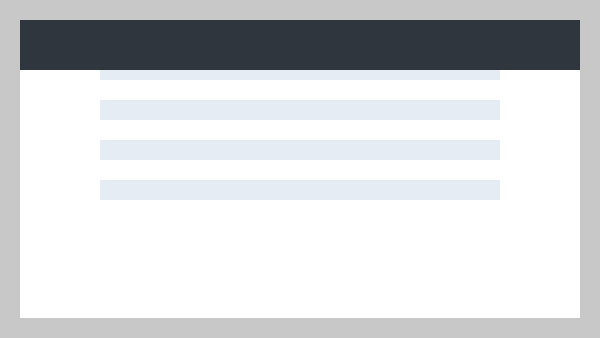

# ICOM6045 L5 — Firewalls and Tunnels Study Notes

### Format: EN · 资料 / EN · 录音 / 中 / 📍 Source · 原始幻灯片图

> 🔴 Core · 🟠 Required · 🟢 Context · 📄F = L5 PPTX · 📼 = recording

## 1. Firewalls

**资料图示**

*图：📄F p.12 — 该页原始幻灯片，展示防火墙规则表。*

#### 🔴 Packet-filtering firewall
> **EN · 资料** · A packet-filtering firewall operates at the network layer and filters packets based on source/destination address and port.
> **EN · 录音** · "A packet filtering firewall looks at the header, the source, the destination, and the port number."
> **中** · 包过滤防火墙工作在网络层，按地址与端口过滤数据包。
> **📍 Source** · 📄F p.12 · 📼 Recording (2026-11-17, 16:30)

#### 🟢 Stateful inspection
> **EN · 资料** · 无对应引文
> **EN · 录音** · "Stateful inspection keeps track of the connection state."
> **中** · 状态检测会跟踪连接状态。
> **📍 Source** · 📼 Recording (2026-11-17)

## 2. Source Page-Map

### 📄F — Firewalls and Tunnels deck
| Page | Content | Mapped to § | Necessity | Treatment | Image |
|------|---------|-------------|-----------|-----------|-------|
| 📄F p.12 | Firewall rule table | §1 | 🔴 | Expanded | figures/F_p12.png |
| 📄F p.13 | (blank — section divider) | — | — | Skip (blank) | — (blank) |
